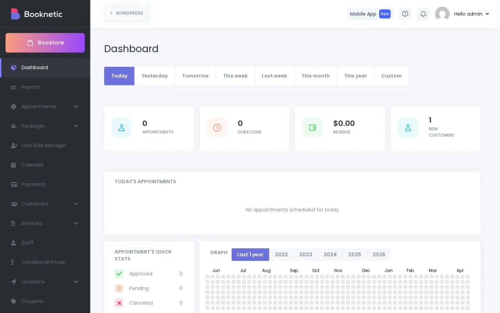
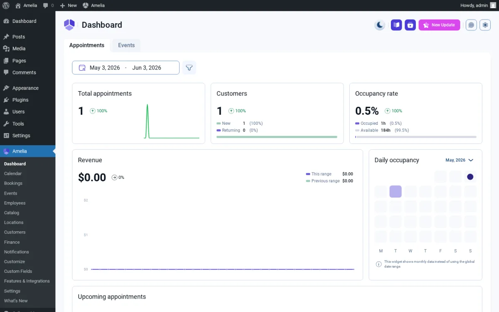
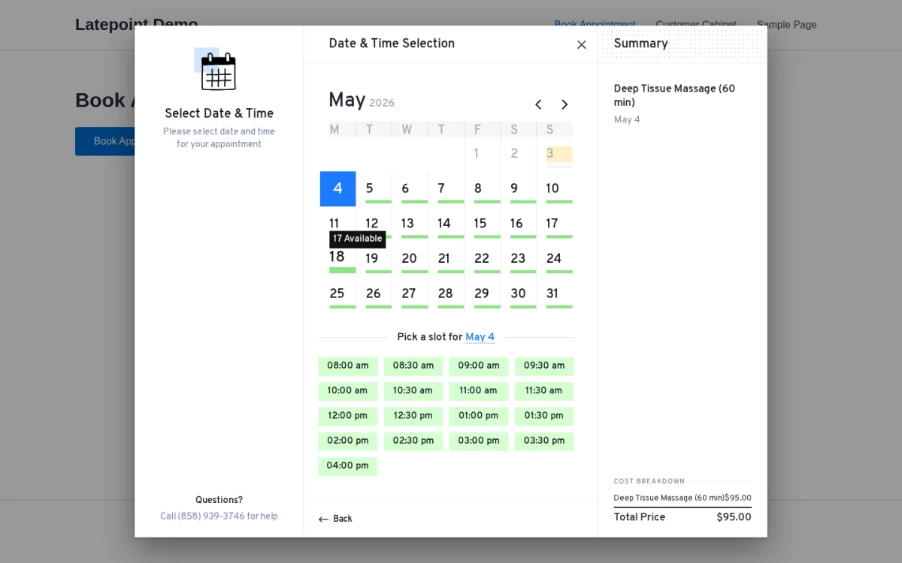
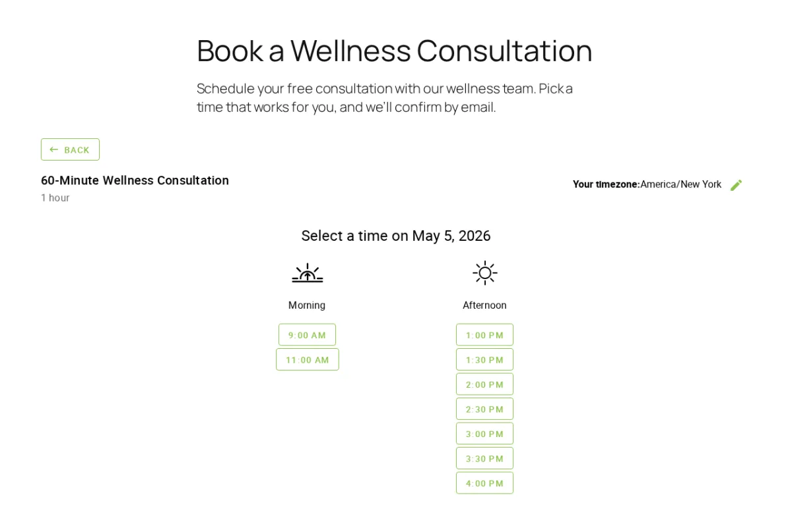
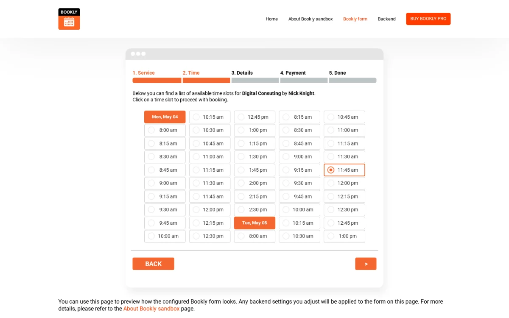
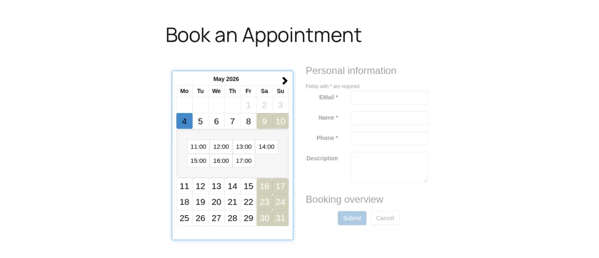
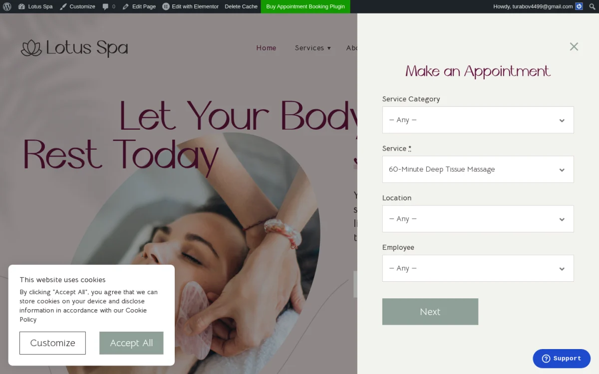

# Best WordPress Booking Plugins in 2026 (8 Tested and Scored)

The best WordPress booking plugins in 2026, ranked after installing each one, booking an appointment end to end and scoring it out of 100. Booknetic scored highest at 90/100. Amelia and LatePoint follow at 81 and 80. The other five sit between 55 and 68.

Every plugin was set up with one service, one staff member and one schedule, then booked as a customer. This list gives you the score table, one real screenshot per plugin, strengths, limitations, current prices and the right pick for each use case. Prices and WordPress.org numbers were checked on 22 October 2026.

## Quick picks

| # | Plugin | Best for | Starting paid price | Score |
|---|--------|----------|---------------------|-------|
| 1 | [Booknetic](https://www.booknetic.com/) | Full-featured booking for service businesses | $45/yr ($99 lifetime) | 90/100 |
| 2 | [Amelia](https://wpamelia.com/) | Service businesses that also run events | $49/yr | 81/100 |
| 3 | [LatePoint](https://latepoint.com/) | Modern admin with all features in every paid plan | $99/yr ($249 lifetime) | 80/100 |
| 4 | [FluentBooking](https://fluentbooking.com/) | Calendly-style scheduling inside WordPress | $79/yr ($249 lifetime) | 68/100 |
| 5 | [Simply Schedule Appointments](https://simplyscheduleappointments.com/) | Accessibility-first widget with a 5-minute setup | $129/yr | 68/100 |
| 6 | [Bookly Pro](https://www.booking-wp-plugin.com/) | Modular add-on stack with per-recipient email templates | $99/yr ($129 lifetime) | 68/100 |
| 7 | [Easy Appointments](https://easy-appointments.com/) | Multi-location, multi-staff schedules without WP accounts | $39 one-time | 57/100 |
| 8 | [MotoPress Appointment Booking](https://motopress.com/products/appointment-booking/) | Per-service deposits and group bookings on a short wizard | $49/yr ($149 lifetime) | 55/100 |

## How the plugins were tested

Each plugin was installed on a fresh WordPress site or an official vendor sandbox, configured with one service, one staff member, one location and one schedule, then booked end to end as a customer. The appointment had to land in the admin. Pricing pages, documentation, changelogs and public ratings on WordPress.org, CodeCanyon, Capterra, Trustpilot and G2 were cross-checked afterwards.

| Plugin | Version tested | Environment |
|--------|----------------|-------------|
| Booknetic | 5.10.4 | Fresh WordPress install with core Boostore add-ons active |
| Amelia | 9.9.1 | Licensed environment with Amelia Pro active |
| LatePoint | 5.7.5 | Hosted sandbox with the full paid add-on stack |
| FluentBooking | 2.5.0 | Fresh sandbox with FluentBooking Pro |
| Simply Schedule Appointments | 1.6.12.37 | Clean install with the Pro Edition |
| Bookly Pro | 28.6 | Official sandbox with 40+ paid add-ons |
| Easy Appointments | 4.0.3 | Fresh install, free WordPress.org build |
| MotoPress Appointment Booking | 2.4.8 | Official Lotus Spa demo with Pro features |

Scores are editorial. Seven weighted categories add up to 100 points: booking flow (20), admin usability (15), feature depth (20), payments and integrations (15), automation and notifications (10), pricing and value (10), reputation and support (10).

### Score breakdown

| Plugin | Booking flow (20) | Admin (15) | Features (20) | Payments (15) | Automation (10) | Value (10) | Reputation (10) | Total |
|--------|---:|---:|---:|---:|---:|---:|---:|---:|
| Booknetic | 18 | 14 | 19 | 13 | 9 | 8 | 9 | **90** |
| Amelia | 17 | 13 | 17 | 13 | 8 | 6 | 7 | **81** |
| LatePoint | 16 | 14 | 13 | 13 | 8 | 8 | 8 | **80** |
| FluentBooking | 13 | 13 | 10 | 8 | 8 | 6 | 10 | **68** |
| Simply Schedule Appointments | 14 | 13 | 11 | 9 | 6 | 5 | 10 | **68** |
| Bookly Pro | 13 | 9 | 14 | 10 | 7 | 6 | 9 | **68** |
| Easy Appointments | 9 | 9 | 12 | 8 | 5 | 8 | 6 | **57** |
| MotoPress Appointment Booking | 12 | 8 | 10 | 8 | 5 | 7 | 5 | **55** |

Three plugins tie at 68. FluentBooking ranks fourth because Twilio SMS, WhatsApp, webhooks and every integration are included in the $79 Solo plan. Simply Schedule Appointments ranks fifth because it beat Bookly on booking flow and admin usability. Bookly Pro ranks sixth because its feature lead only appears once the paid add-on stack is installed.

---

## 1. Booknetic

**[Booknetic](https://www.booknetic.com/)** is a self-hosted WordPress booking plugin with a dedicated admin app, a workflow automation builder and a native staff app. It scored highest in this comparison.

The booking widget runs through Location, Staff, Service, Date and Time, Information, Cart and Confirmation. The cart step shows the price, a coupon field and the payment method before the customer submits. The Date and Time step pairs a calendar with a slot list that needs no scrolling.

The admin replaces the WordPress chrome entirely. The dashboard opens on revenue, upcoming appointments and today's schedule. The calendar covers Month, Week, Day and List views and reschedules by drag and drop. The Workflow module fires email, SMS, WhatsApp, Telegram, webhook and Mailchimp actions on appointment created, rescheduled and cancelled triggers without code.

| | |
|---|---|
| **Score** | 90/100 |
| **Best for** | Service businesses, agencies and multi-location brands |
| **Starting paid price** | $45/year (Basic) or $99 lifetime |
| **Free version** | Free build from booknetic.com (not on WordPress.org) |
| **Rating** | 4.91/5 from 471 reviews on CodeCanyon |

**Strengths**

- Dedicated admin app with 25 own database tables and 195 REST routes under `booknetic/v1`.
- Workflow builder in the core: triggers fire email, SMS, WhatsApp, Telegram, webhook and Mailchimp actions.
- Drag-and-drop admin calendar with Month, Week, Day and List views.
- Add-on catalog with 10 payment gateways (Stripe, PayPal, Square, Mollie, Razorpay, Mercado Pago, Vipps, 2Checkout, Netopia, WooCommerce), two-way Google Calendar and Outlook sync, Zoom and Google Meet, and a native iOS and Android staff app.

**Limitations**

- Basic ($45/year) includes no add-ons. Online payments, Google Calendar, SMS and white-labeling need Standard or above, or a separate Boostore purchase, and add-on prices are not published on the site.
- The free build ships a 980px-wide branding bar that widens the booking page on phones.
- Recent CodeCanyon reviews complain about add-on price increases and support response times.

**Pricing:** $45/year or $99 lifetime on Basic. Standard, Premium and Elite add more domains and bundle more add-ons. 14-day money-back guarantee.

Full test write-up: [8 Best WordPress Appointment Booking Plugins (2026, Tested)](https://www.booknetic.com/blog/best-wordpress-appointment-booking-plugins?utm_source=github&utm_medium=readme&utm_campaign=best-wordpress-booking-plugins)

---

## 2. Amelia

**[Amelia](https://wpamelia.com/)** is the right pick when appointments and ticketed events run on the same site. The events module ships inside the same plugin, with QR-coded e-tickets.

The Date and Time step splits the screen: calendar on the left, 30-minute slot strip on the right. The Payments step shows the service summary and every available payment method before the customer confirms. The confirmation page is one of the strongest in the category. It lists the appointment ID, date, service, employee, location address, payment line and four Add to Calendar shortcuts.

The admin dashboard surfaces total appointments, occupancy rate and revenue with comparison ranges on the first screen. Six live-preview Customize editors cover the booking forms.

| | |
|---|---|
| **Score** | 81/100 |
| **Best for** | Service businesses that also run events, classes or ticketed sessions |
| **Starting paid price** | $49/year (Starter) |
| **Free version** | Amelia Lite on WordPress.org, 90,000+ active installs |
| **Rating** | 4.6/5 from 790 reviews on WordPress.org |

**Strengths**

- Built-in Events module with QR-coded e-tickets next to appointments.
- Admin dashboard with appointments, occupancy rate and revenue over comparison ranges.
- Notifications matrix with email and SMS templates for Approved, Pending, Rejected, Rescheduled, Reminder, Follow-up, Package, Waiting list and Events.
- Square payments, including Apple Pay and Google Pay, in every tier including Lite. Google, Outlook and Apple calendar sync plus Zoom, Google Meet and Teams from Standard.

**Limitations**

- Tier gating: Stripe, PayPal, Mollie, Razorpay, calendar sync and video meetings start at Standard ($99/year). Packages, resources, cart and waiting list need Pro. REST API and the mobile app need Elite.
- Free Lite has no calendar sync, no recurring appointments, no deposits and no gateway other than Square.
- Trustpilot 3.6/5 from 263 reviews. Recent 1-star reviews cite SMS reminders not firing and breaking changes after the v9 release.

**Pricing:** Free Lite on WordPress.org. Starter from $49/year. Higher tiers add multi-site licensing, deeper integrations and lifetime options. 15-day money-back guarantee.

---

## 3. LatePoint

**[LatePoint](https://latepoint.com/)** has the cleanest SaaS-style admin in this list and sells every add-on in every paid plan. No per-add-on calculator.

The booking flow is step by step and responsive. The Date and Time step shows a calendar grid with a slot list grouped by time of day. First-time customers pass an OTP gate on the final step. The Appointment Confirmed page shows service, staff, date, time and location with Add to Calendar and Print buttons.

The admin loads as an isolated panel. The WordPress sidebar disappears. The Booking Form Settings customizer is the most capable live-preview editor tested here: colour picker, live preview and a drag-to-reorder Steps panel.

| | |
|---|---|
| **Score** | 80/100 |
| **Best for** | Solo professionals and small studios that want a modern admin and one all-inclusive paid plan |
| **Starting paid price** | $99/year (Starter, 1 site) or $249 lifetime |
| **Free version** | On WordPress.org, 100,000+ active installs |
| **Rating** | 4.9/5 from 105 reviews on WordPress.org |

**Strengths**

- Isolated admin with Performance, Upcoming and Day Preview cards on the dashboard.
- Booking Form Settings customizer with live preview, colour picker and drag-to-reorder steps.
- Every add-on in every paid plan: Google, Outlook and Apple Calendar, Zoom, Twilio SMS, WhatsApp, Mailchimp, WooCommerce, nine payment gateways and the Pro Features bundle (custom fields, locations, webhooks, group bookings, bundles, coupons).
- Widest hook surface in this list: 245 actions and 334 filters, 117 of them documented, plus 6 Gutenberg blocks and 8 shortcodes.

**Limitations**

- Free tier: single location, no extra agents, no custom fields, no two-way Google Calendar sync, no recurring appointments.
- No per-language booking forms with WPML or Polylang. Strings translate through gettext only.
- No native mobile app and no documented REST API. Zapier only through generic webhooks.

**Pricing:** Free on WordPress.org with Stripe Connect, PayPal and Razorpay. Starter from $99/year or $249 lifetime for 1 site. An introductory $79 first-year price was showing at the time of writing. 14-day money-back guarantee.

---

## 4. FluentBooking

**[FluentBooking](https://fluentbooking.com/)** is the closest thing to Calendly inside WordPress. Host page, event list, two clicks to a slot, and the data stays on your site.

The public booking page is themeless by default: host card at the top, event list below, a Book Now button per event. The date picker shows a month grid with available dates and a 30-minute slot list alongside. The confirmation page lists What, When, Who and Where, the attendee's note, inline Cancel and Reschedule links and Add to Calendar shortcuts.

The Event Type editor organizes everything across 11 tabs, from Availability and Limits to Payment, Webhooks and Integrations. A working event is live in under two minutes.

| | |
|---|---|
| **Score** | 68/100 |
| **Best for** | Coaches, consultants and sales teams that want Calendly-style scheduling inside WordPress |
| **Starting paid price** | $79/year (Solo, 1 site) or $249 lifetime |
| **Free version** | On WordPress.org, 20,000+ active installs |
| **Rating** | 4.7/5 from 46 reviews on WordPress.org |

**Strengths**

- Calendly-shaped public booking page, two clicks from Book Now to a selected slot.
- Confirmation page with inline Cancel and Reschedule links and Add to Calendar shortcuts.
- Google Calendar, Outlook, Apple and Nextcloud sync, Zoom OAuth, Twilio SMS, WhatsApp and webhooks included in every Pro tier.
- Native integration with FluentCRM, Fluent Forms, FluentSMTP and FluentCart. Booking questions map to Fluent Forms fields since 2.5.0.

**Limitations**

- Payment gateways limited to Stripe, PayPal, WooCommerce, FluentCart and Pay Locally.
- No booking packages, no customer portal, no native mobile app.
- The admin booking detail screen shows no Cancel or Reschedule action for the host.

**Pricing:** Free on WordPress.org. Solo from $79/year or $249 lifetime for 1 site. Higher tiers add sites at the same feature level. 14-day money-back guarantee.

---

## 5. Simply Schedule Appointments

**[Simply Schedule Appointments](https://simplyscheduleappointments.com/)** is the fastest plugin here from install to a live widget, and the only one with a built-in WCAG contrast checker.

The Setup Wizard detects timezone, date format and time format on first run. A working booking widget was live in under 5 minutes. The Expanded layout groups available times into Morning and Afternoon blocks and excludes the lunch gap. The confirmation page puts Save to Calendar, Reschedule and Cancel on the page itself.

The Styles tab includes a live WCAG contrast-ratio checker that warns when the chosen accent colour fails readability. No other plugin in this comparison takes accessibility that seriously.

| | |
|---|---|
| **Score** | 68/100 |
| **Best for** | Solo consultants and small sites that value accessibility and a fast, clean setup |
| **Starting paid price** | $129/year (Plus, 1 site), lifetime from $299 |
| **Free version** | Basic on WordPress.org, 50,000+ active installs |
| **Rating** | 5.0/5 from 155 reviews on WordPress.org |

**Strengths**

- Setup Wizard with timezone and format detection, widget live in under 5 minutes.
- Three booking layouts (Expanded, Express, First Available) and multiple availability blocks per day.
- Live WCAG contrast-ratio checker in the Styles tab.
- Google Calendar, Zoom, Google Meet, Gravity Forms, Formidable Forms and MemberPress from Plus. Stripe, PayPal, Twilio SMS, webhooks and Google Analytics from Professional.

**Limitations**

- No drag-and-drop admin calendar. Appointments are managed in a list view and a CSV export.
- Email notifications are plain text. The vendor FAQ confirms HTML cannot be embedded.
- The booking form renders inside an iframe that loads about 2.96 MB, and the widget calls ip2c.org for the visitor's location.

**Pricing:** Free Basic on WordPress.org. Plus from $129/year for 1 site ($99 introductory first year at the time of writing). Professional and Business ($499/year regular) add SMS, team scheduling and resource booking. Lifetime plans from $299. 30-day money-back guarantee.

---

## 6. Bookly Pro

**[Bookly Pro](https://www.booking-wp-plugin.com/)** has the largest add-on catalog and the strongest review volume in the category. The admin is the oldest-looking one in this list.

The Time step prints a summary line before the customer advances: service, staff member, date and price together. The admin calendar shows colour-coded time blocks in Day view. The dashboard surfaces KPI cards and an analytics datatable.

The Email Notifications module is the strongest non-widget feature. It covers every booking event split by recipient (Customer, Staff, Admin) with full HTML templates and a rich set of tokens.

| | |
|---|---|
| **Score** | 68/100 |
| **Best for** | Businesses that assemble features from a large add-on catalog and need per-recipient HTML email templates |
| **Starting paid price** | $99/year (Pro, 1 site) or $129 lifetime |
| **Free version** | On WordPress.org, 60,000+ active installs |
| **Rating** | 4.4/5 from 585 reviews on WordPress.org, 4.5/5 from 1,200 ratings on CodeCanyon |

**Strengths**

- Summary line with service, staff, date and price before the customer advances.
- Per-event, per-recipient HTML email templates with template tokens.
- 40+ add-ons: Stripe, two-way Google Calendar, recurring appointments, multiple locations, custom fields, deposits, group booking, waiting list and taxes. Business and Ultimate bundles pack the common ones.
- Free core with 1 staff member and 5 services, email notifications and SMS campaigns through Bookly Cloud. An AI Assistant booking form arrived in releases 28.3 to 28.6.

**Limitations**

- Pro alone has no Stripe, no two-way Google Calendar, no recurring appointments, no multiple locations and no custom fields. Each is a separate paid add-on.
- Admin UI is visibly older than the others. No drag-and-drop reschedule on the calendar in Pro.
- Loads about 1.2 MB of assets on every page by default and calls ipinfo.io from the visitor's browser.

**Pricing:** Free base on WordPress.org. Pro from $99/year or $129 lifetime for 1 site. A $39/year sale price was showing at the time of writing. 30-day money-back guarantee.

---

## 7. Easy Appointments

**[Easy Appointments](https://easy-appointments.com/)** is the most credible truly free option here. The core is free with unlimited sites, services and employees. The frontend looks dated.

The booking widget shows the calendar and a Personal Information form side by side. After a date is selected, the slot picker highlights the slot in green and shows a Booking Overview panel. The flow works. It is not polished.

The admin Connections list holds the unique data model. One Connection ties a Location, a Service, an Employee and a working schedule into a single bookable row. Shared rooms, multi-clinic staff and complex schedules need no custom code.

| | |
|---|---|
| **Score** | 57/100 |
| **Best for** | Clinics and salons with shared rooms or staff across locations, modelled as connections without WordPress user accounts |
| **Starting paid price** | $39 one-time (Pro extension, 1 site) |
| **Free version** | On WordPress.org, 10,000+ active installs |
| **Rating** | 4.3/5 from 131 reviews on WordPress.org |

**Strengths**

- Connection model: Location + Service + Employee + schedule in one row.
- Employees are their own entity, not WordPress users. A salon with 12 staff needs no 12 WP accounts.
- Three frontend shortcodes and two Gutenberg blocks, a booking form design selector since 4.0.3.
- GDPR auto-removal, per-role access controls and reCAPTCHA v2 and v3 in the free build.

**Limitations**

- Frontend widget is visibly dated.
- Post-submit "Done" confirmation is a bare heading: no booking ID, no calendar shortcut, no "Book another" link.
- Every integration (calendar sync, SMS, online payments, AI assistant) needs the paid Pro extension. The free build takes on-site payment only.

**Pricing:** Core free on WordPress.org, unlimited sites. Pro extension from $39 one-time for 1 site with one year of updates. Pro adds two-way Google Calendar, Twilio SMS and WhatsApp, Stripe, PayPal, Razorpay, WooCommerce payments, iCal feeds, an AI Booking Assistant and room and resource booking.

---

## 8. MotoPress Appointment Booking

**[MotoPress Appointment Booking](https://motopress.com/products/appointment-booking/)** has the most generous free tier and the fairest Pro price in this list. The install base is small.

The multi-step wizard auto-skips steps with only one option, so a single-staff setup stays short. The Date and Time step pairs a month grid with a list of 30-minute slots. The confirmation page shows service, date and time with Add to Calendar shortcuts for Google, Apple, Outlook and Yahoo.

The service form covers per-service deposits (fixed or percentage), group booking settings and buffer time. Working hours live on a separate Schedule entity, which first-time admins find confusing.

| | |
|---|---|
| **Score** | 55/100 |
| **Best for** | Small service teams that need per-service deposits and group bookings on a short wizard |
| **Starting paid price** | $49/year (Pro, 1 site) or $149 lifetime |
| **Free version** | Lite on WordPress.org, 2,000+ active installs |
| **Rating** | 4.5/5 from 21 reviews on WordPress.org |

**Strengths**

- Wizard auto-skips single-option steps.
- Add to Calendar shortcuts for Google, Apple, Outlook and Yahoo on the confirmation page.
- Per-service deposit, group booking and buffer time on the service form.
- Free Lite includes unlimited services, employees and locations with on-site payment. Add-ons for Twilio SMS, Zoom, invoicing and more are sold separately or in the Bundle plan.

**Limitations**

- Service-to-location wiring is indirect through the Schedule entity.
- No native mobile app. No drag-and-drop reschedule on the admin calendar.
- About 2,000 active installs, so community help and third-party tutorials are scarce.

**Pricing:** Free Lite on WordPress.org, unlimited sites. Pro from $49/year or $149 lifetime for 1 site. The Bundle plan wraps 7 official add-ons. 30-day money-back guarantee, conditions apply.

---

## Full comparison table

| Plugin | Starting paid price | Free version | Rating | Score | Key strength |
|--------|---------------------|--------------|--------|-------|--------------|
| Booknetic | $45/yr ($99 lifetime) | booknetic.com | 4.91/5 (471, CodeCanyon) | 90 | Feature depth, workflow automation, native mobile app |
| Amelia | $49/yr | WordPress.org | 4.6/5 (790, WP.org) | 81 | Built-in events module with QR e-tickets |
| LatePoint | $99/yr ($249 lifetime) | WordPress.org | 4.9/5 (105, WP.org) | 80 | Cleanest admin, all features in every paid plan |
| FluentBooking | $79/yr ($249 lifetime) | WordPress.org | 4.7/5 (46, WP.org) | 68 | Calendly-style experience inside WordPress |
| Simply Schedule Appointments | $129/yr | WordPress.org | 5.0/5 (155, WP.org) | 68 | Accessibility and a 5-minute setup |
| Bookly Pro | $99/yr ($129 lifetime) | WordPress.org | 4.4/5 (585, WP.org) | 68 | Largest add-on catalog, highest review volume |
| Easy Appointments | $39 one-time | WordPress.org | 4.3/5 (131, WP.org) | 57 | Free core with unlimited sites, services and employees |
| MotoPress Appointment Booking | $49/yr ($149 lifetime) | WordPress.org | 4.5/5 (21, WP.org) | 55 | Generous free Lite tier |

Prices are the regular starting paid prices on 22 October 2026. Sales are common in this category, so check the vendor page before buying.

## A note for developers

If you plan to extend the plugin rather than only configure it, the differences are bigger than the scores suggest.

| Plugin | Free build | Min PHP | Latest release (Oct 2026) | Extension surface |
|--------|-----------|---------|---------------------------|-------------------|
| Booknetic | booknetic.com | 7.4 | 5.10.4 | 195 REST routes under `booknetic/v1`, 25 own tables, webhook action in the Workflow builder |
| Amelia | WordPress.org (Lite 2.4.13) | 7.4 | 9.9.1 premium | REST API gated to the Elite tier, six live-preview Customize editors |
| LatePoint | WordPress.org (5.7.5) | 7.4 | 5.7.5 | 245 actions, 334 filters (117 documented), 6 Gutenberg blocks, 8 shortcodes, webhooks in Pro Features |
| FluentBooking | WordPress.org (2.5.0) | 7.4 | 2.5.0 | Webhook feeds per event type, Fluent Forms field mapping, FluentCRM triggers |
| Simply Schedule Appointments | WordPress.org (1.6.12.37) | 7.4 | 1.6.12.37 | `ssa/v1` REST namespace, webhooks from Professional, booking form inside an iframe |
| Bookly Pro | WordPress.org (28.6) | 5.3.7 | 28.6 | Add-on architecture, 1.2 MB of assets on every page by default |
| Easy Appointments | WordPress.org (4.0.4) | 5.3 | 4.0.4 | 3 shortcodes, 2 Gutenberg blocks, employees stored as own entities |
| MotoPress Appointment Booking | WordPress.org (Lite 2.4.8) | 7.4 | 2.4.8 | Shortcodes and blocks, 7 official add-ons, Schedule entity separate from services |

Three things to check before you commit. Whether the data model fits your reporting needs (Booknetic, Amelia, LatePoint and Bookly keep their own tables, SSA and Easy Appointments keep far fewer). Whether an event you need fires a hook or a webhook without a paid tier. And how much the plugin loads on pages that have no booking form at all.

## Which plugin should you choose?

- Strongest overall booking system with workflow automation, a native mobile app and a large add-on marketplace: **Booknetic**.
- Appointments and ticketed events or classes on the same site: **Amelia**.
- Cleanest modern admin with every feature in one paid plan: **LatePoint**.
- Calendly-style one-on-one and group scheduling inside WordPress: **FluentBooking**.
- A single site where accessibility, a clean widget and the fastest setup matter: **Simply Schedule Appointments**.
- Features assembled from a large add-on catalog plus per-recipient HTML email templates: **Bookly Pro**.
- Multi-location, multi-staff schedules without WordPress accounts for staff: **Easy Appointments**.
- Per-service deposits and group bookings on a short wizard: **MotoPress Appointment Booking**.

## FAQ

### What is the best WordPress booking plugin in 2026?

Booknetic earned the highest score in this comparison (90/100) across booking flow, feature depth, admin usability, automation and public reputation. Amelia and LatePoint are the most credible alternatives, depending on whether you weight built-in events or admin polish more.

### Which WordPress booking plugin has the most payment gateways?

Booknetic and LatePoint. Booknetic sells 10 gateway add-ons (Stripe, PayPal, Square, Mollie, Razorpay, Mercado Pago, Vipps, 2Checkout, Netopia, WooCommerce) and the Elite plan bundles all of them. LatePoint includes Stripe Connect, PayPal, Razorpay, Square, Mollie, MercadoPago, Flutterwave, Braintree, Paystack and WooCommerce in every paid plan, and the first three work on the free plugin.

### Which plugin is best for Google Calendar sync?

Booknetic, LatePoint, FluentBooking, Bookly Pro (add-on), Simply Schedule Appointments, Easy Appointments Pro and MotoPress Pro all offer two-way sync. Amelia needs Standard or above. The LatePoint and Easy Appointments free tiers do not include it.

### Is a free WordPress booking plugin enough for a small business?

For one staff member and on-site payments, yes. Easy Appointments and MotoPress Lite have no per-feature limits. Bookly's free base and LatePoint's free plugin are real products too. Once you need Stripe or PayPal, two-way Google Calendar, multiple locations, SMS reminders or branded notifications, most free tiers run out of room.

### Should I use a WordPress plugin or a SaaS scheduler like Calendly or Acuity?

Choose a plugin when you want data ownership, one-time or annual pricing and a booking flow embedded in your own site. Choose SaaS when you do not run on WordPress or want a hosted product team to handle infrastructure. For most WordPress-based service businesses the plugin route wins on long-term cost and integration depth.

### What is the best booking plugin for salons, clinics or multi-location businesses?

Booknetic is the closest fit. It handles multi-location and multi-staff booking in the core, has add-ons for deposits, packages, gift cards and loyalty points, and ships a native mobile app for staff. Amelia from Standard (unlimited locations) and MotoPress with the Bundle plan are credible alternatives on tighter budgets.

### Which plugin is easiest to set up for a non-technical user?

Simply Schedule Appointments, typically under 5 minutes through its Setup Wizard. LatePoint's live-preview booking form customizer is the most beginner-friendly appearance editor. FluentBooking gets from zero to a bookable event in under two minutes.

## About this list

Maintained by [FS Code](https://www.fs-code.com/), the company behind Booknetic. Booknetic is included in the comparison and ranked by the same model as every other plugin. The scores, screenshots and prices come from the test described above, published in full on the [Booknetic blog](https://www.booknetic.com/blog/best-wordpress-appointment-booking-plugins?utm_source=github&utm_medium=readme&utm_campaign=best-wordpress-booking-plugins).

Corrections are welcome. Open an issue or a pull request with a link to the vendor page that shows the right price or feature. Text is licensed under [CC BY 4.0](https://creativecommons.org/licenses/by/4.0/). Screenshots belong to the respective plugin vendors and are used for review purposes.
